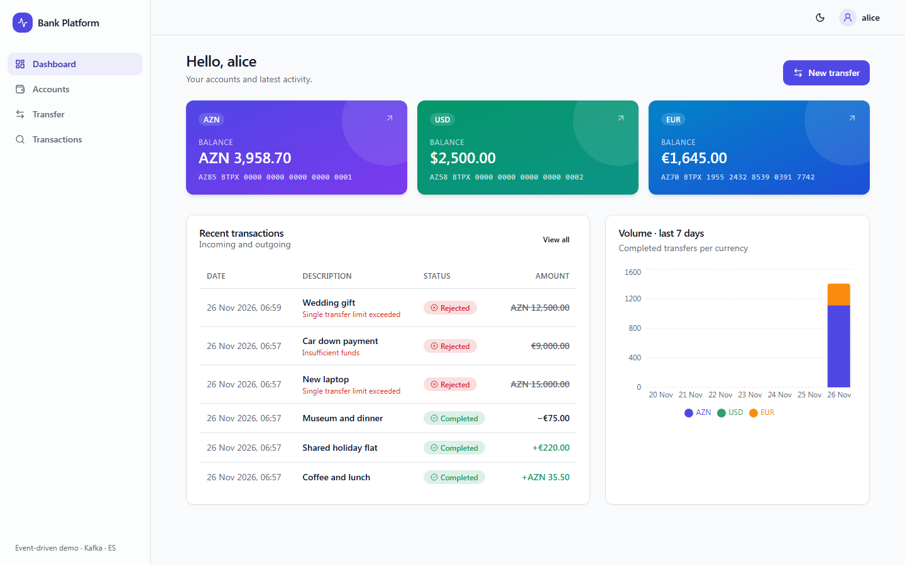
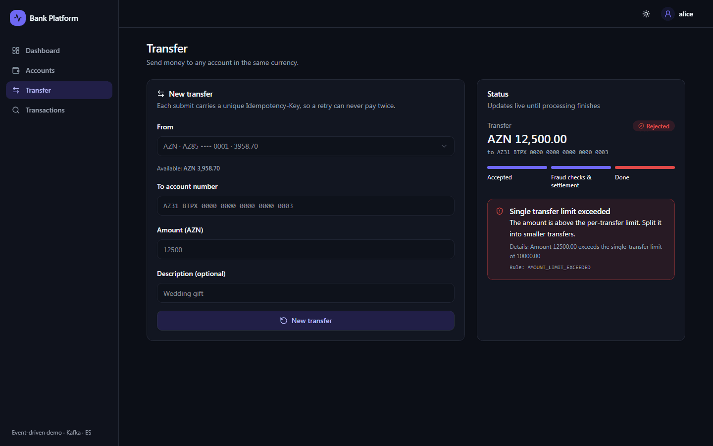
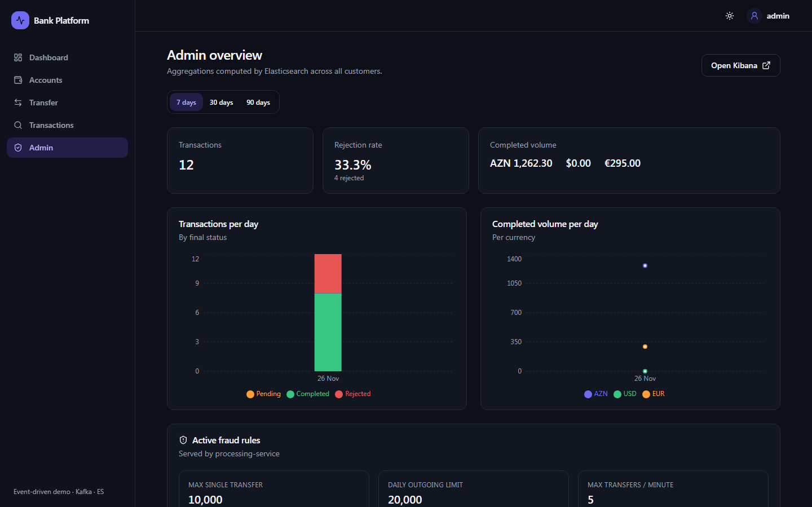
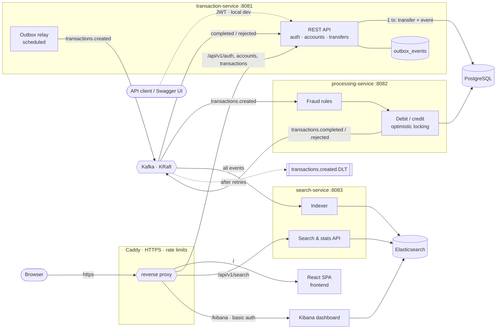
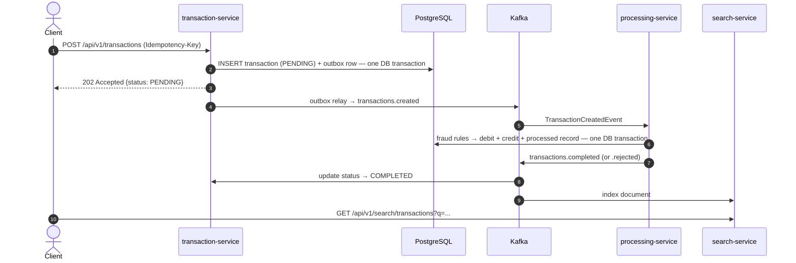
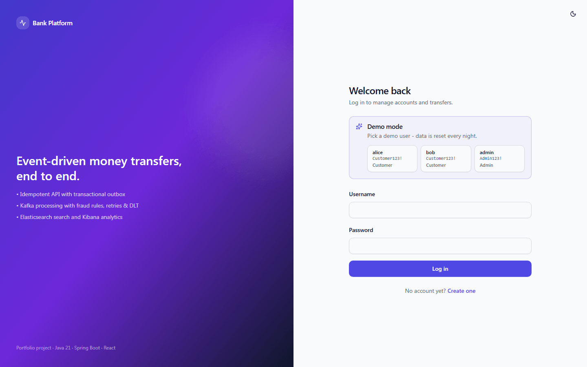
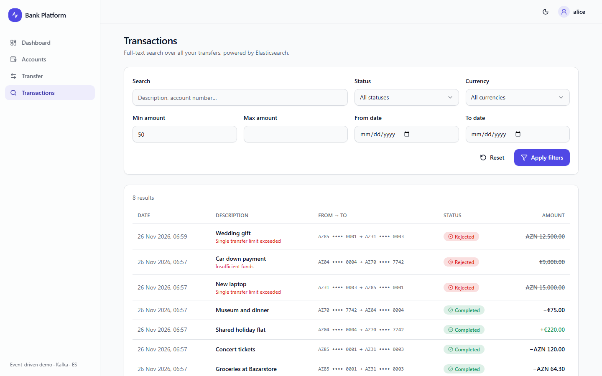
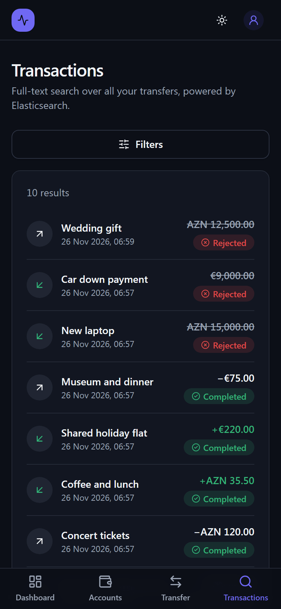
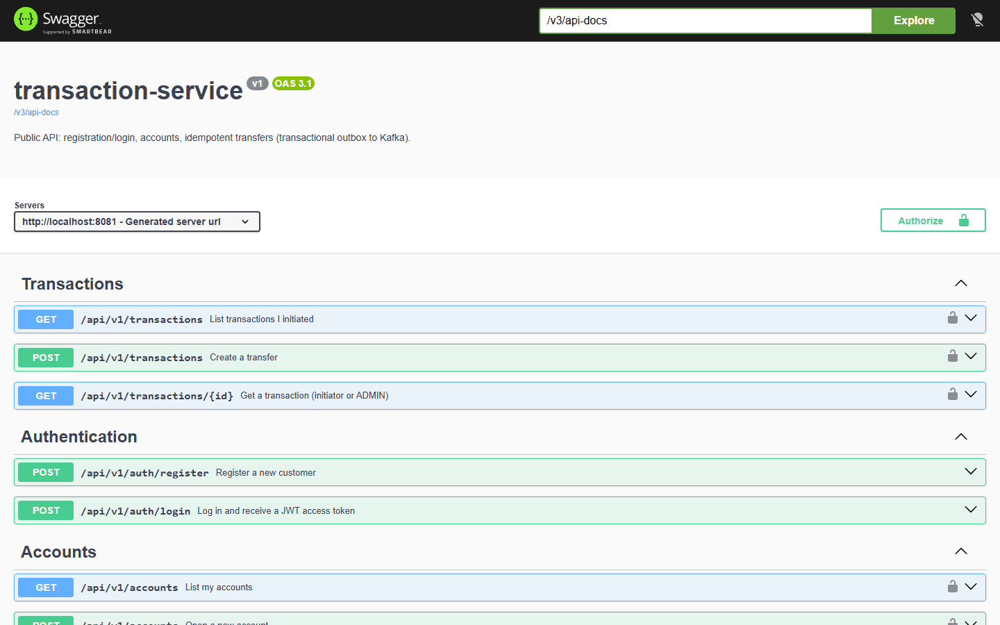
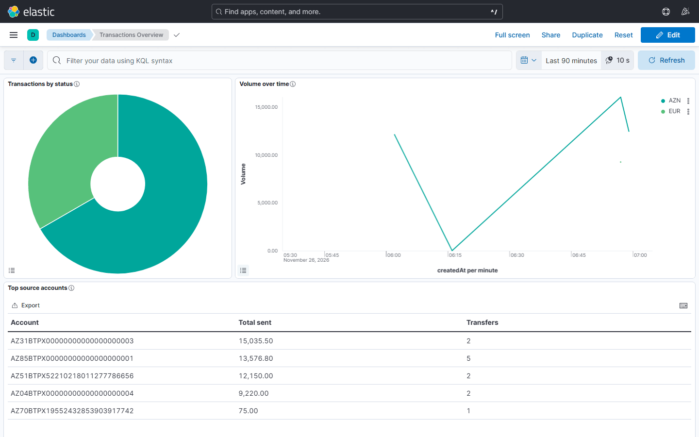

# Bank Transaction Platform

[](https://github.com/OWNER/bank-transaction-platform/actions/workflows/ci.yml)


An **event-driven money-transfer platform**, built the way real payment systems are built: a Java 21 /
Spring Boot backend on Kafka, PostgreSQL and Elasticsearch, plus a React dashboard. It runs with one
command, and every claim below is covered by an automated test.

A customer sends money from the web app. The transfer is accepted immediately, then checked for
fraud and settled asynchronously over Kafka, and finally becomes searchable in Elasticsearch and
visible on a Kibana dashboard.

## Live demo

**👉 https://YOUR-SUBDOMAIN.duckdns.org** *(placeholder until deployed)*

| User | Password | What to try |
|---|---|---|
| `alice` | `Customer123!` | Send money to Bob (`AZ31BTPX00000000000000000003`) and watch the status go live from *Pending* to *Completed* |
| `bob` | `Customer123!` | Send 99,999 AZN and see the fraud rule reject it, with the reason shown |
| `admin` | `Admin123!` | Admin analytics charts and the Kibana dashboard |

The login page has one-click demo buttons, and the demo data is reset every night. It runs on a single
free Oracle Cloud ARM VM, set up as described in [deploy/DEPLOY.md](deploy/DEPLOY.md).

| Dashboard | Live transfer status | Admin analytics |
|---|---|---|
|  |  |  |

### Real banking problems this project solves

| Problem | Solution in this codebase |
|---|---|
| A client retries a payment after a timeout. **Is the customer charged twice?** | Required `Idempotency-Key` header, enforced by a DB unique constraint; replays return the original result |
| The DB commit succeeds but the Kafka publish fails. **Is the payment lost?** | **Transactional outbox**: the transfer and its event are written in one DB transaction and relayed to Kafka afterwards |
| Two transfers debit the same account at the same moment | `BigDecimal` money, `@Version` **optimistic locking** and a `CHECK (balance >= 0)` constraint |
| A Kafka message is redelivered after a crash | **Idempotent consumer**: the decision is stored with the balance change and re-emitted, never re-applied |
| A malformed message would block the partition forever | **Retry with exponential backoff, then a Dead Letter Topic** (`transactions.created.DLT`) |
| Suspicious activity | Rule-based **fraud checks**: per-transfer limit, daily limit, transfers-per-minute velocity |
| "Show me all rejected USD transfers over 1,000 last week" | **Elasticsearch read model (CQRS)** with filters, full-text search and aggregations |
| One request touches three services: which log lines belong together? | A **correlation id** travels in HTTP headers and Kafka headers; services log as JSON (ECS) |

---

## Architecture



### Life of a transfer



| Service | Responsibility | Owns |
|---|---|---|
| **common** | Sealed event hierarchy, wire format, JWT, RFC 7807 errors, correlation id, Kafka infrastructure (Spring Boot auto-configuration) | – |
| **transaction-service** | Registration/login (JWT), accounts with IBAN-style numbers, idempotent transfers, outbox relay, status updates | `users`, `accounts`, `transactions`, `outbox_events` |
| **processing-service** | Fraud rules, atomic balance moves, idempotent consumer, retry + DLT | schema `processing` |
| **search-service** | Builds the Elasticsearch read model from all events; search and admin aggregations | index `transactions` |
| **frontend** | React SPA: dashboard, accounts, live transfer status, search, admin charts | – |
| **Caddy** (prod) | Single public entry point: HTTPS, routing by path, rate limits, Kibana basic auth | TLS certificates |

---

## Run in 1 minute

Requirements: Docker with Compose v2 and about 6 GB of free RAM.

```bash
docker compose up -d --build
```

The first build downloads dependencies and takes a few minutes. After that, startup takes about a minute.
Wait until everything is healthy:

```bash
docker compose ps
```

| What | URL |
|---|---|
| transaction-service Swagger UI | http://localhost:8081/swagger-ui.html |
| processing-service Swagger UI | http://localhost:8082/swagger-ui.html |
| search-service Swagger UI | http://localhost:8083/swagger-ui.html |
| Kafka UI (topics, messages, DLT) | http://localhost:8090 |
| Kibana "Transactions Overview" dashboard | http://localhost:5601/app/dashboards#/view/transactions-overview |
| Health | http://localhost:8081/actuator/health (same for 8082 and 8083) |

**Web app (dev server with hot reload).** Requires Node 22. The Vite dev server proxies `/api` to the
three services, so no CORS setup is needed:

```bash
cd frontend && npm ci && npm run dev      # → http://localhost:5173
```

To run **everything, web app included, exactly as in production** (Caddy in front, one origin),
use the production compose file with `DOMAIN=localhost`. See
[deploy/DEPLOY.md](deploy/DEPLOY.md#troubleshooting) (*Test the production stack locally*).

**Demo data** (seeded by the `dev` profile; in production by `DEMO_MODE=true` under the `prod` profile):

| User | Password | Role | Accounts |
|---|---|---|---|
| `admin` | `Admin123!` | ADMIN | – |
| `alice` | `Customer123!` | CUSTOMER | `AZ85BTPX00000000000000000001` (AZN 5,000) · `AZ58BTPX00000000000000000002` (USD 2,500) |
| `bob` | `Customer123!` | CUSTOMER | `AZ31BTPX00000000000000000003` (AZN 1,200) · `AZ04BTPX00000000000000000004` (EUR 800) |

> The defaults in `docker-compose.yml` are for local development only. To override them,
> copy `.env.example` to `.env`. No real secrets are committed.

Stop the stack with `docker compose down`. Add `-v` to also delete the data.

---

## Try it: the full flow with curl

> Examples use `jq` to extract values. On Windows, run them in Git Bash or WSL.

**1. Register and log in**

```bash
curl -s -X POST localhost:8081/api/v1/auth/register -H 'Content-Type: application/json' \
  -d '{"username":"charlie","password":"Charlie123!","fullName":"Charlie Hasanov"}'

TOKEN=$(curl -s -X POST localhost:8081/api/v1/auth/login -H 'Content-Type: application/json' \
  -d '{"username":"charlie","password":"Charlie123!"}' | jq -r .accessToken)
```

**2. Open accounts.** `initialDeposit` simulates a cash deposit (maximum 10,000).

```bash
ACC=$(curl -s -X POST localhost:8081/api/v1/accounts -H "Authorization: Bearer $TOKEN" \
  -H 'Content-Type: application/json' -d '{"currency":"AZN","initialDeposit":1000}' | jq -r .number)

curl -s -X POST localhost:8081/api/v1/accounts -H "Authorization: Bearer $TOKEN" \
  -H 'Content-Type: application/json' -d '{"currency":"USD"}'

curl -s localhost:8081/api/v1/accounts -H "Authorization: Bearer $TOKEN" | jq
```

**3. Transfer to Bob.** Note the `Idempotency-Key` header.

```bash
KEY=$(uuidgen 2>/dev/null || cat /proc/sys/kernel/random/uuid)
TX=$(curl -s -X POST localhost:8081/api/v1/transactions \
  -H "Authorization: Bearer $TOKEN" -H 'Content-Type: application/json' \
  -H "Idempotency-Key: $KEY" -H 'X-Correlation-Id: demo-flow-1' \
  -d "{\"sourceAccount\":\"$ACC\",\"targetAccount\":\"AZ31BTPX00000000000000000003\",\"amount\":150.00,\"currency\":\"AZN\",\"description\":\"Concert tickets\"}" \
  | jq -r .id)
# -> 202 Accepted, status PENDING
```

Send the same request again with the same key. You get `200`, the header `Idempotent-Replayed: true`
and the **same** transaction id. No money moves a second time.

**4. Check the result.** It is `COMPLETED` in well under a second:

```bash
curl -s localhost:8081/api/v1/transactions/$TX -H "Authorization: Bearer $TOKEN" | jq
curl -s localhost:8081/api/v1/accounts/$ACC/balance -H "Authorization: Bearer $TOKEN" | jq
```

**5. Trigger the fraud rules and search**

```bash
# rejected: above the single-transfer limit (10,000)
curl -s -X POST localhost:8081/api/v1/transactions -H "Authorization: Bearer $TOKEN" \
  -H 'Content-Type: application/json' -H "Idempotency-Key: $(uuidgen 2>/dev/null || cat /proc/sys/kernel/random/uuid)" \
  -d "{\"sourceAccount\":\"$ACC\",\"targetAccount\":\"AZ31BTPX00000000000000000003\",\"amount\":12000,\"currency\":\"AZN\"}"

curl -s "localhost:8083/api/v1/search/transactions?q=concert" -H "Authorization: Bearer $TOKEN" | jq
curl -s "localhost:8083/api/v1/search/transactions?status=REJECTED&account=$ACC" -H "Authorization: Bearer $TOKEN" | jq
curl -s "localhost:8083/api/v1/search/transactions?minAmount=100&maxAmount=500&from=2026-01-01T00:00:00Z" \
  -H "Authorization: Bearer $TOKEN" | jq
```

**6. Admin aggregations.** Totals per day, status and currency:

```bash
ADMIN=$(curl -s -X POST localhost:8081/api/v1/auth/login -H 'Content-Type: application/json' \
  -d '{"username":"admin","password":"Admin123!"}' | jq -r .accessToken)
curl -s localhost:8083/api/v1/search/transactions/stats -H "Authorization: Bearer $ADMIN" | jq
```

**Errors are RFC 7807 problem details**, and each one carries the correlation id:

```json
{
  "type": "https://bank-platform.dev/problems/idempotency-key-reused",
  "title": "Idempotency key reused",
  "status": 422,
  "detail": "This Idempotency-Key was already used for a different request",
  "instance": "/api/v1/transactions",
  "errorCode": "idempotency-key-reused",
  "correlationId": "demo-flow-1",
  "timestamp": "2026-11-26T10:15:30.123Z"
}
```

---

## Design decisions

### Why the transactional outbox?
Writing to the database and publishing to Kafka are two separate systems. With no distributed
transaction between them, "save, then publish" loses events on a crash, and "publish, then save"
announces transfers that never happened. The transfer and its `TransactionCreatedEvent` are
therefore saved in **one PostgreSQL transaction**. A scheduled relay
([`OutboxPublisher`](transaction-service/src/main/java/com/bankplatform/transaction/outbox/OutboxPublisher.java))
then sends unpublished rows to Kafka and marks a row published only after the broker acknowledges it.

- `SELECT … FOR UPDATE SKIP LOCKED` lets several instances relay in parallel without sending the same row twice.
- On failure the batch stops, so the events of one account keep their order.
- Delivery is *at-least-once*. Every consumer is idempotent, so a rare duplicate is harmless.

### Why idempotency keys?
Networks fail after the server has done the work. The client cannot tell "not received" from
"response lost", so it retries. The `Idempotency-Key` header turns that retry into a safe replay:
- A `UNIQUE (initiator_id, idempotency_key)` constraint guarantees it even under concurrent requests.
  The losing request catches the violation and returns the winner's result.
- A SHA-256 fingerprint of the request body is stored with the key. Reusing a key for a *different*
  request returns `422`, so a client bug cannot silently fetch the wrong result.
- Replays return `200` with `Idempotent-Replayed: true`. The first call returns `202 Accepted`.

### Why `BigDecimal` and optimistic locking?
- `double` cannot represent `0.10` exactly, so rounding errors accumulate. All money is `BigDecimal`
  in Java and `NUMERIC(19,2)` in the database, and the scale is validated at the API.
- Accounts carry a `@Version`. When two transfers race on the same balance, one commit fails with an
  optimistic-lock exception, and the Kafka error handler **retries it with backoff** against the
  fresh balance. This avoids long-held row locks and never loses an update.
- `CHECK (balance >= 0)` in the schema is the last line of defence, independent of application code.

### Why an idempotent consumer instead of Kafka transactions?
processing-service commits the debit, the credit and a `processed_transactions` row in **one DB
transaction**, then publishes the result. If the publish fails, the record is redelivered, the
stored decision is found, and the *same* result event (deterministic event id) is published again.
No money moves twice, and no XA or Kafka-transaction coupling with the database is needed.

### Retries and the Dead Letter Topic
Retries are blocking, with exponential backoff (1s → 2s → 4s → 8s, capped at 10s), which keeps
per-account ordering. A record that still fails is parked on `transactions.created.DLT`, with the
exception and the original correlation id in its headers, so it can be inspected in Kafka UI.
Unparseable *poison messages* skip the retries and go to the DLT immediately.

### Other decisions
- **Sealed event hierarchy.** `TransactionEvent` is `sealed`. Consumers use `switch` pattern
  matching, so the compiler flags any event type that is not handled.
- **Partitioning by source account.** All events of one account are processed in order.
- **Order-independent read model.** Events of one transaction arrive on different topics in any
  order. The Elasticsearch document applies them as a commutative merge (a final status is never
  downgraded) and uses `seq_no`/`primary_term` for optimistic concurrency.
- **Authorization in search.** Each document stores the user ids of both account owners. Customers
  only ever see transactions that touch their own accounts. Stats are `ADMIN` only.
- **Shared accounts table, a documented trade-off.** transaction-service owns and migrates
  `accounts`, and processing-service updates balances in it through its own minimal entity. This
  keeps the demo to a single database. In production the ledger would be its own service with its
  own store, and transaction-service would keep a balance projection fed by events.
- **Virtual threads** (`spring.threads.virtual.enabled=true`) serve HTTP requests and scheduled jobs.

---

## Tests

```bash
./mvnw clean verify      # Docker must be running (Testcontainers)
```

| Level | What | Examples |
|---|---|---|
| Unit (JUnit 5, Mockito) | Business logic in isolation | idempotent replay and key reuse, outbox ordering on failure, each fraud rule, processor idempotency, read-model merge order, IBAN check digits, JWT |
| Integration (Testcontainers) | One service against real Postgres, Kafka and Elasticsearch | outbox → Kafka with the correlation header, status update from a result event, balances moved, poison message → DLT, search filters and authorization |
| **End-to-end** | `e2e-tests` starts the **three real executable jars** as separate processes and drives them over HTTP only | transfer → processed → `COMPLETED` → searchable, plus a rejection for insufficient funds; the correlation id appears in the processing-service logs |

**Frontend** (`cd frontend && npm test`): Vitest and Testing Library cover the login flow (demo
buttons, validation, ProblemDetail errors), the role-based route guards, the API client's error
mapping, the live transfer status with its rejection reasons, and the chart and filter logic.

CI ([`.github/workflows/ci.yml`](.github/workflows/ci.yml)) runs the full Maven `verify`, the
frontend's lint, format check, tests and build, validates both compose files, and builds every
Docker image on each push and pull request.

---

## Frontend

React 18 + TypeScript + Vite, Tailwind CSS with shadcn/ui components, React Router, TanStack Query,
React Hook Form + Zod and Recharts. It supports light and dark mode and is fully responsive: a sidebar
on desktop and a bottom tab bar on phones.

- **One typed API client** ([`src/api`](frontend/src/api)) mirrors the backend DTOs. Every non-2xx
  response becomes an `ApiError` that carries the server's RFC 7807 problem detail, and a global
  TanStack Query handler shows it as a toast.
- **Auth.** The JWT is kept in memory for requests and mirrored to `localStorage`, so a reload keeps
  the session. The user is logged out automatically when the token expires or the API answers 401.
  Route guards enforce the `ADMIN` role.
- **Transfers.** Every submit sends a fresh `Idempotency-Key` (UUID). The page then polls
  `GET /transactions/{id}` until the status is `COMPLETED` or `REJECTED`, and explains which fraud
  rule rejected the transfer.
- **Search.** Filters live in the URL, so a result list can be shared and survives reloads.
- **Admin.** Daily totals per status and currency from search-service, the active fraud limits from
  processing-service, and a link to Kibana.

## Deployment

`docker-compose.prod.yml` runs the whole platform on **one free Oracle Cloud ARM VM**
(2 OCPU / 12 GB). Every image is multi-arch, and the memory limits add up to about 7.5 GB.
Only Caddy is public: it handles automatic HTTPS for a DuckDNS domain, routes by path so the browser
sees a single origin (no CORS, no mixed content), rate-limits login and transfers, and protects
Kibana with basic auth. A cron job resets the demo data every night.

👉 Step-by-step guide for beginners: **[deploy/DEPLOY.md](deploy/DEPLOY.md)**

---

## Project structure

```
bank-transaction-platform/
├── common/                 shared events, wire format, JWT, ProblemDetail, correlation id (auto-configuration)
├── transaction-service/    REST API, idempotency, outbox, Flyway migrations, demo seed
├── processing-service/     fraud rules, ledger updates, retry + DLT
├── search-service/         Elasticsearch read model, search and stats
├── e2e-tests/              black-box flow test across all services
├── frontend/               React + TypeScript SPA (Vite, Tailwind, shadcn/ui)
├── deploy/                 Caddy image, setup-server.sh, deploy.sh, reset-demo.sh, DEPLOY.md
├── kibana/                 dashboard.ndjson + init.sh (imported by the kibana-init container)
├── docs/screenshots/
├── docker-compose.yml      local development stack
├── docker-compose.prod.yml single-VM production stack
├── .env.example
└── .env.prod.example
```

Every service follows the same layering: `controller → service → repository`. DTOs are records,
separate from the JPA entities, and are mapped with MapStruct.

---

## Screenshots

| | |
|---|---|
| Login with demo mode |  |
| Dashboard |  |
| Transfer with live status |  |
| Transaction search |  |
| Admin analytics |  |
| Mobile |  |
| Swagger UI |  |
| Kafka UI with the DLT |  |
| Kibana "Transactions Overview" |  |

---

## Tech stack

**Backend:** Java 21 · Spring Boot 3.5 (Web, Security, Data JPA, Data Elasticsearch, Actuator,
Validation) · Spring for Apache Kafka · Apache Kafka 3.9 (KRaft) · PostgreSQL 17 + Flyway ·
Elasticsearch and Kibana 8.18 · JJWT · springdoc-openapi · MapStruct · Lombok · JUnit 5, Mockito,
AssertJ, Awaitility, Testcontainers

**Frontend:** React 18 · TypeScript · Vite · Tailwind CSS · shadcn/ui (Radix) · React Router ·
TanStack Query · React Hook Form + Zod · Recharts · Vitest + Testing Library · ESLint + Prettier

**Ops:** Docker multi-stage, multi-arch builds · Caddy (automatic HTTPS, rate limiting) ·
GitHub Actions · Oracle Cloud Always Free (ARM64)
